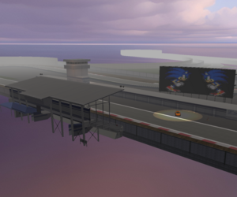
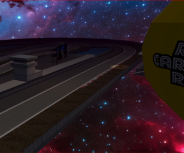
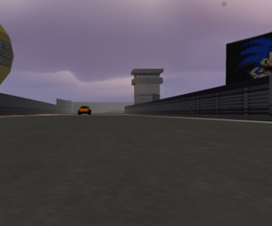

# Star*Track

**Made by: [@Dulla-han](https://github.com/Dulla-han)**

The goal was to create a 3D scene of a real racing circuit, in this case Tsukuba Circuit, in which the user can move freely. The scene contains additional models, such as three racing cars that repeatedly complete a lap in 25 seconds, hot air balloons, and a screen showing a film for the audience.

Although the area in which the user can move freely is limited, the program can be switched to flight mode, which allows unrestricted movement throughout the entire scene.

The scene contains two static cameras: the first offers a view of the finishing straight directly from the track, while the second offers a view from the audience. Two additional cameras are dynamic: the first follows a Porsche from the control tower, while the second offers a third-person view of the car. The user can rotate the static cameras. All camera views transition smoothly using linear interpolation.

The user can also switch between day and night or recolor any object except the skybox red using the left mouse button. The original color of the object can then be restored.

Parameters such as lap duration, rotation sensitivity, movement speed (both walking and running), and others can be configured in the `config.txt` file, which can be edited and reloaded while the program is running.

## Controls

| Key / button | Function | Mode |
| --- | --- | --- |
| **W** | Move forward | Hold |
| **S** | Move backward | Hold |
| **A** | Move left | Hold |
| **D** | Move right | Hold |
| **Shift + movement** | Sprint in the direction of movement | Hold |
| **Mouse movement** | Rotate view | — |
| **C** | Flight mode | Toggle |
| **Left mouse button** | Recolor object red | Press |
| **R + left mouse button** | Restore original object color | Press |
| **Space** | Change skybox – day/night | Toggle |
| **1** | Free mode | Toggle |
| **2** | First dynamic camera from the tower | Toggle |
| **3** | First static camera overlooking the finishing straight | Toggle |
| **4** | Second dynamic camera from the car | Toggle |
| **5** | Second static camera from the grandstands | Toggle |
| **Right mouse button** | Rotate static camera view | Hold |
| **Esc** | Exit the program | Press |
